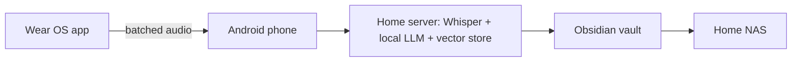

# ParentsPad Second Brain — Showcase

An always-listening second brain built around the **Galaxy Watch** you already wear. It captures conversations, hands the audio to the phone, and turns the day into **searchable transcripts, summaries, action items and memories**.

## The problem
Important details from meetings, calls and conversations get lost. Wearable recorders exist, but they mean extra hardware and send data to someone else's cloud.

## Intent and vision
- Always on while worn, one-tap mute, auto-pause off the wrist
- Battery-smart: voice detection on the watch and batched transfers
- **Local-first:** transcription and AI summaries run on a home server with open models. Nothing leaves home by default.
- Your AI, your choice: cloud models only if turned on per feature
- Notes land where Steven takes notes: an Obsidian vault, synced to the home NAS
- Call cliff-notes from the phone's own call recordings

## Status
Phase 0: research, plan and team brief done. Note-merge test cases are written. App code starts next.

## Architecture

## Tech stack
Kotlin (Wear OS and Android), faster-whisper, Ollama with Gemma, local vector store, Obsidian, Syncthing.

## Roadmap
Phase 1 capture and transcription, then summaries and action items, then To Do and OneNote integration.

---
**Source code is private.** This showcase describes the project and is updated as it progresses.
